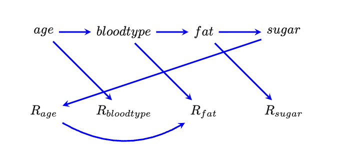

# JHUFall2026FunctionalFinalProjectTJB

Trung Phung, Jung Yoon, Benjamin Albeyta

## Overview of the purpose of the project

Missing data is a pervasive problem in data science. It happens when there are "?" or "NA" symbol in the data table, instead of the usual values. This project is the state-of-the-art imputation algorithm for data missing-not-at-random. This will be accomplished through the use of a variety of sampling techniques, such as a sample from an assumed uniform distribution, or gibbs sampling; in relation to user provided CSV data sets; and a graph giving the relations between the provided data.

## Complete Mock use of the application

A mock use of the application would include the folder_path data_filename, vertex_filename, edge_filename, method name and result_filename. The user would provide the folder the exe would be pointed at in folder_path, as well as the name of the provided data file, the vertex data file name and the edge data file name; all of which are CSV files. Alongside the method name (the amount of methods we are going to implement depends on time so I will not list out all possibilities here) and a result filename which will make a new file with the unknown data filled in based on the method specified by the user; this file will be created in the same folder specified.

### Inputs

The content of the `datafile.csv`, with `NA` denotes missing value.

| age | bloodtype | fat | sugar |
| --- | --------- | --- | ----- |
| 30  | A         | 1.2 | 3.4   |
| 31  | NA        | 3.2 | 7.4   |
| 32  | A-        | NA  | NA    |
| NA  | O         | NA  | 3.7   |
| 34  | B+        | 3.2 | 1.3   |

The content of the `vertex.txt`

```txt
age, bloodtype, fat, sugar, R_age, R_bloodtype, R_fat, R_sugar
```

The content of the `edge.txt`

```txt
(age, bloodtype), (bloodtype, fat), (fat, sugar)
(age, R_bloodtype), (bloodtype, R_fat), (fat, R_sugar), (sugar, R_age)
(R_age, R_fat)
```

### Commands

We plan to use 3 methods (MICE, EM, PM).
They are different way to impute the data.
Therefore, for user, inputs and outputs are the same,
only the internal working is different.

To impute, user needs to type into the command line

```zsh
impute.exe datafile.csv vertex.txt edge.txt MICE
impute.exe datafile.csv vertex.txt edge.txt PM
```

### Outputs

Then the program will create 2 files in the `./result` folder

First file is the `imputed_data.csv`, with `NA` replaced by appropriate value.

| age | bloodtype | fat  | sugar |
| --- | --------- | ---- | ----- |
| 30  | A         | 1.2  | 3.4   |
| 31  | A         | 3.2  | 7.4   |
| 32  | A-        | 12.2 | 5.9   |
| 33  | O         | 1.5  | 3.7   |
| 34  | B+        | 3.2  | 1.3   |

Second file is a nice-to-have image `graph.png`


This is the end of the program.


## Libraries

We will be using the OCamlGraph library, which we have specified works in demo subfolder. 

## Commented module type declarations

See the (.mli files) in `./src`

## Implementation plan:

a list of the order in which you will implement features and by what date you hope to have them completed.
TP JY BA

| Task                                            | Responsible | To-Do Date | Completed | Comments |
| ----------------------------------------------- | ----------- | ---------- | --------- | -------- |
| Create .mli Files                               | TP/JY       | 11/18/2026 | Done      |          |
| Install OCaml Graphs library                    | All         | 11/18/2026 | Done      |          |
| Finish the Design.md doc                        | BA          | 11/18/2026 | Done      |          |
| Create Basic Dune files                         | All         | 11/18/2026 |           |          |
| Simple first implementation of method EM        | TP          | 11/25/2026 |           |          |
| Create CSV intake processing                    | TBD         | 11/22/2026 |           |          |
| Graph operations: d-sep, parent, markov blanket | TP          | 11/28/2026 |           |          |
| Create --help lines                             | JY          | 11/18/2026 |           |          |
| Create CSV output processing                    | TBD         | 11/23/2026 |           |          |
| Create Base Sampling                            | TBD         | 11/30/2026 |           |          |
| Create Tests for base sample type               | TBD         | 11/30/2026 |           |          |
| Create structure for choosing sample type       | TBD         | 11/20/2026 |           |          |
| Create / implement main                         | TBD         | 12/1/2026  |           |          |
| Implement method PM                             | TBD         | 12/6/2026  |           |          |

## Other info

This is the general structure for the files in our project:
Data
  InitalData.cvs graph.cvs method.txt
src
  Library
    graph etc etc
  Sampling
    Each file contains code for each sampling method
  Processing
    File for taking in data into code, file for putting out data into code, functordefinition.ml, module type, d-seperation file
  bin
    main.ml, test.ml